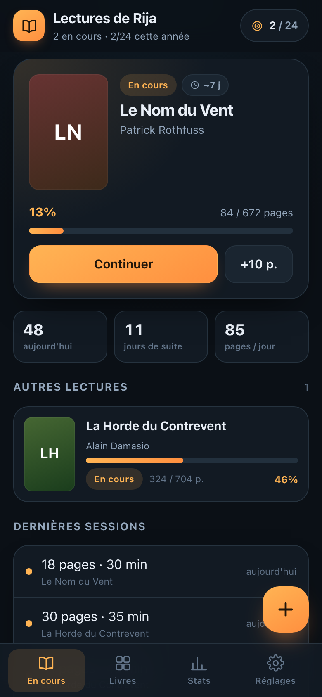
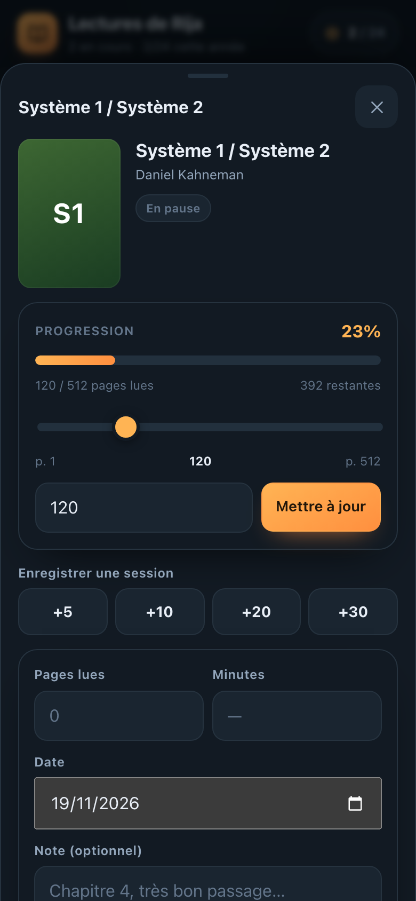
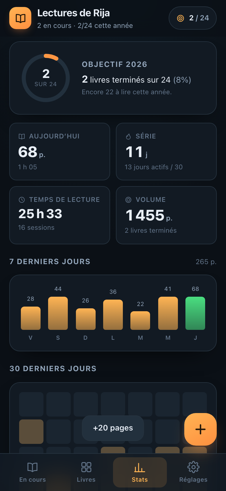

# Suivi de lectures

Application personnelle de suivi de lectures : progression page par page, sessions,
séries, objectif annuel. Interface **mobile first** en français, installable sur
l'écran d'accueil, **zéro dépendance** (Node.js seul, pas de build).



| Fiche d'un livre | Statistiques | Découvrir |
| --- | --- | --- |
|  |  |  |

## Démarrer

```bash
node server.js
# → http://127.0.0.1:8787
```

Ou avec npm :

```bash
npm start        # démarrage
npm run dev      # redémarrage auto à chaque modification
```

Il n'y a **rien à installer** : pas de `npm install`, pas de bundler, pas de base de
données. Node.js 22+ suffit (testé sur v22.23.5).

## Utiliser l'application depuis le téléphone

L'application est sur votre ordinateur ; le téléphone y accède par le Wi-Fi.

```bash
# 1. Trouver l'adresse IP locale du Mac
ipconfig getifaddr en0        # ex. 192.168.1.24

# 2. Écouter sur le réseau local
HOST=0.0.0.0 PORT=8787 node server.js
```

Puis ouvrir `http://<IP-du-Mac>:8787` sur le téléphone (même Wi-Fi).

**Installer comme une app :**

- iPhone / Safari : Partager → « Sur l'écran d'accueil »
- Android / Chrome : menu ⋮ → « Installer l'application »

L'interface passe en plein écran, respecte les encoches et la barre de gestes.

> ⚠️ `HOST=0.0.0.0` expose l'application à tout votre réseau local, sans mot de passe.
> C'est voulu pour un usage personnel à la maison ; ne l'ouvrez pas sur un réseau public
> et ne redirigez pas le port depuis Internet.

## Ce qu'elle fait

**Accueil — « En cours »**

- le livre le plus récemment lu mis en avant, avec son pourcentage et une estimation de
  la date de fin selon votre rythme des 14 derniers jours ;
- un bouton « +10 p. » pour enregistrer une progression d'un seul geste ;
- trois compteurs : pages lues aujourd'hui, série de jours consécutifs, rythme moyen ;
- les autres lectures en cours et les dernières sessions.

**Livres**

- recherche instantanée par titre, auteur ou tag ;
- filtres par statut : à lire, en cours, terminés, en pause, abandonnés ;
- barre de progression et statut sur chaque carte.

**Fiche d'un livre**

- curseur de page (mise à jour immédiate) ou saisie directe du numéro de page ;
- boutons rapides +5 / +10 / +20 / +30 pages ;
- session détaillée : pages, minutes, date, note ;
- historique des sessions, avec suppression ;
- notes de lecture (sauvegarde automatique) ;
- note de 1 à 5 étoiles, statut, nombre de pages ;
- suppression du livre et de son historique.

**Découvrir — recommandations**

- suggestions tirées de trois signaux : vos genres choisis, les auteurs de vos livres
  terminés ou bien notés, et vos tags ;
- explication affichée pour chaque suggestion (« Parce que vous aimez la science-fiction »,
  « Parce que vous avez lu Frank Herbert », « Vos envies : voyage ») ;
- ajout à la bibliothèque en un geste, ou rejet définitif (« ne plus me proposer ») ;
- 26 genres sélectionnables, grille repliable pour garder les suggestions en haut de l'écran ;
- filtrage local : pas de livre déjà possédé, pas d'ouvrage jeunesse hors du genre Jeunesse,
  pas de traduction illisible, deux livres maximum par auteur, cache de 5 minutes.

**Stats**

- anneau de progression de l'objectif annuel ;
- pages du jour, série, temps de lecture total, volume total ;
- graphique des 7 derniers jours et carte de chaleur de 30 jours ;
- progression et date de fin estimée de chaque lecture en cours.

**Réglages**

- nom affiché, objectif annuel ;
- thème sombre (par défaut) ou clair « papier » ;
- export JSON complet, restauration d'une sauvegarde.

## Remplir la bibliothèque

Deux façons d'ajouter un livre :

1. **Recherche Open Library** (bouton + → « Chercher dans Open Library ») : catalogue
   ouvert et gratuit. Le titre, l'auteur, le nombre de pages et la couverture sont
   préremplis ; vous validez.
2. **Saisie manuelle** : titre, auteur, pages.

Dans la fiche d'un livre, **Fichier de lecture** permet d'ajouter un PDF
de 200 Mo maximum ou un EPUB de 50 Mo maximum. **Lire le PDF** ouvre le lecteur
intégré. **Télécharger** récupère le PDF ou l'EPUB pour
le lire hors ligne. Les EPUB s'ouvrent dans un lecteur compatible.
Les clients compatibles peuvent reprendre un téléchargement interrompu
si le fichier joint n'a pas changé.

Quand le MCP est configuré, **Chercher une édition** interroge aussi ses
sources avec le titre et l'auteur de la fiche. **Récupérer** télécharge
l'édition sélectionnée sur le serveur et l'associe à cette fiche.
Les notices d'édition d'Open Library restent consultables si un fournisseur
de fichiers échoue. Les possibilités de lecture ou d'emprunt figurent sur
la page de chaque notice.
Avec un nombre de pages renseigné, **Trouver le PDF** essaie jusqu'à trois
éditions compatibles de Library Genesis. Parmi les éditions de pagination
proche, il essaie d'abord les fichiers les plus légers. Une recherche récente
peut être réutilisée. Le serveur vérifie le nombre de
pages réellement présent dans le PDF avant de l'ajouter. Une différence de
pagination est tolérée pour les variantes d'édition. Le fichier déjà joint
est conservé tant qu'aucun PDF compatible n'est confirmé.

## Comment la progression est calculée

Un livre stocke un décalage (`offset`) et une liste de **sessions**. La page courante vaut
`offset + somme des pages des sessions`.

Conséquences utiles :

- « j'ai lu 30 pages » et « je suis à la page 120 » sont le même événement ;
- revenir en arrière corrige la position sans créer de session négative ;
- supprimer une session recalcule proprement la progression ;
- un livre qui atteint sa dernière page passe tout seul en « Terminé » ;
- un livre marqué « Terminé » à la main (lu en papier, pages non suivies) **n'est jamais**
  rouvert automatiquement ; seul un livre terminé automatiquement le sera si vous
  corrigez la progression à la baisse.

## Données et sauvegarde

- Le suivi est stocké dans `data/library.json`. Les pièces jointes vivent dans
  `data/reading-files/` et restent associées aux identifiants des livres.
- Chaque écriture est atomique : fichier temporaire puis `rename`, donc pas de fichier à
  moitié écrit en cas de coupure.
- Si le fichier est corrompu au démarrage, il est conservé sous
  `library.json.corrupt-<horodatage>` et un état vide est créé — rien n'est effacé.
- Export / import JSON du suivi depuis l'écran Réglages (ou `GET /api/export`).
  Pour sauvegarder les fichiers de lecture, copiez aussi `data/reading-files/`.

Pour sauvegarder à la main :

```bash
cp data/library.json ~/Documents/lectures-$(date +%F).json
```

## Configuration

| Variable       | Défaut      | Rôle                                              |
| -------------- | ----------- | ------------------------------------------------- |
| `PORT`         | `8787`      | Port d'écoute                                     |
| `HOST`         | `127.0.0.1` | Interface réseau ; `0.0.0.0` pour le téléphone    |
| `DATA_DIR`     | `./data`    | Dossier des données                               |
| `LOG_REQUESTS` | —           | `1` pour journaliser chaque requête sur stderr    |

## API

Toutes les mutations renvoient l'état complet (livres dérivés + stats), ce qui évite toute
désynchronisation côté client.

| Méthode  | Route                              | Rôle                          |
| -------- | ---------------------------------- | ----------------------------- |
| `GET`    | `/api/state`                       | livres, réglages, statistiques |
| `GET`    | `/api/stats`                       | statistiques seules            |
| `POST`   | `/api/books`                       | créer un livre                 |
| `PATCH`  | `/api/books/:id`                   | modifier un livre              |
| `DELETE` | `/api/books/:id`                   | supprimer un livre             |
| `POST`   | `/api/books/:id/sessions`          | enregistrer des pages lues     |
| `DELETE` | `/api/books/:id/sessions/:sid`     | supprimer une session          |
| `POST`   | `/api/books/:id/progress`          | « je suis à la page X »        |
| `PATCH`  | `/api/settings`                    | nom, objectif, thème, genres   |
| `GET`    | `/api/search?q=`                   | recherche Open Library         |
| `GET`    | `/api/discover?refresh=1`          | recommandations + catalogue de genres |
| `POST`   | `/api/discover/dismiss`            | rejeter une suggestion         |
| `GET`    | `/api/export`                      | télécharger la sauvegarde      |
| `POST`   | `/api/import`                      | restaurer une sauvegarde       |
| `GET`    | `/api/health`                      | vérification de vie            |

## Tests

```bash
# 1. lancer une instance jetable
PORT=8788 DATA_DIR=/tmp/rt-smoke node server.js &

# 2. lancer la suite (84 vérifications : API, validation, persistance, import, recommandations)
node scripts/smoke-test.mjs http://127.0.0.1:8788
```

Les tests couvrent notamment : création/validation, sessions, progression avant et
arrière, fin automatique, préservation d'un « Terminé » manuel, réglages, export/import,
404, JSON invalide et protection contre la traversée de répertoire.

Côté recommandations : catalogue de genres, filtrage des identifiants inconnus, unicité
des suggestions, pas de livre déjà possédé, deux livres maximum par auteur, rejet
persistant et absence des livres rejetés dans le lot suivant.

## Structure

```
server.js              serveur HTTP + routes API + fichiers statiques
lib/store.js           persistance JSON, modèle de livre, statistiques
lib/dates.js           utilitaires de dates locales (YYYY-MM-DD)
lib/openlibrary.js     recherche de métadonnées Open Library
lib/recommend.js       moteur de recommandations (genres, auteurs, tags)
public/index.html      coquille de l'application + icônes SVG
public/app.js          toute l'interface (vanilla JS, modules ES)
public/styles.css      thème sombre/clair, mobile first
public/manifest.webmanifest  installation PWA
scripts/smoke-test.mjs suite de tests API
scripts/make_icons.py  génération des icônes PNG
```

## Limites assumées

- Pas de compte ni de synchronisation multi-appareils : les données vivent sur la machine
  qui fait tourner le serveur.
- Pas de mode hors ligne : l'app suppose le serveur joignable sur le réseau local.
- La recherche Open Library a besoin d'Internet ; la saisie manuelle, non.
- Les recommandations dépendent de la qualité des sujets d'Open Library, qui sont
  communautaires : d'où les filtres (langue, jeunesse, popularité) et le rejet manuel.
  Elles ne sont pas personnalisées au-delà des genres, auteurs et tags que vous fournissez.
